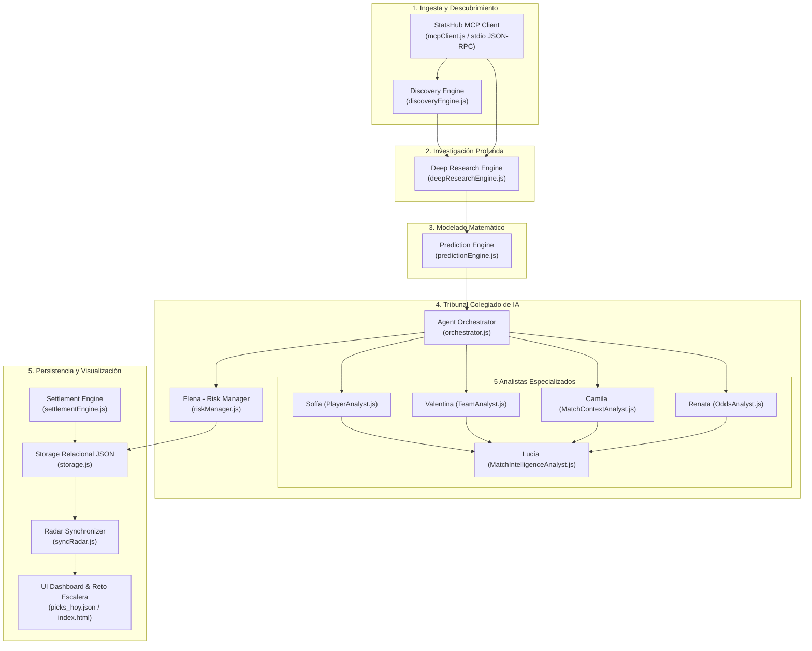
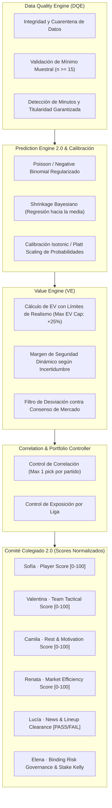
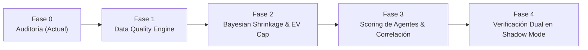

# INFORME DE AUDITORÍA ARQUITECTÓNICA — DARADOR IA 2.0 (FASE 0)

> **Documento:** Auditoría Técnica y Diagnóstico Integral del Motor de Apuestas  
> **Estado:** Fase 0 — Diagnóstico y Mapeo (Sin modificaciones en producción)  
> **Objetivo:** Sentar las bases técnicas para la evolución hacia una arquitectura *Balanced / Quality First*.

---

## 1. Mapeo de la Arquitectura Actual

El sistema actual opera bajo un pipeline secuencial acoplado a través de archivos JSON en disco (`engine/storage_data/`), orquestado periódicamente por el `CentralAutonomousScheduler`.

### 1.1 Diagrama de Flujo y Dependencias Actuales



### 1.2 Componentes y Responsabilidades

| Componente | Archivo Fuente | Responsabilidad Principal | Dependencias Clave |
|---|---|---|---|
| **Discovery Engine** | [discoveryEngine.js](file:///c:/Users/ruben/OneDrive/Escritorio/Proyectos/DaradorIA/engine/discovery/discoveryEngine.js) | Escaneo de fixtures y screeners (`getPropScreener`, `getTeamPropScreener`). | `mcpClient.js`, `storage.js` |
| **Deep Research Engine** | [deepResearchEngine.js](file:///c:/Users/ruben/OneDrive/Escritorio/Proyectos/DaradorIA/engine/research/deepResearchEngine.js) | Enriquecimiento con métricas de 90 min, concedidas por rival y árbitro. | `mcpClient.js`, `config.js` |
| **Prediction Engine** | [predictionEngine.js](file:///c:/Users/ruben/OneDrive/Escritorio/Proyectos/DaradorIA/engine/prediction/predictionEngine.js) | Modelado de Poisson, Binomial Negativa, Ensemble empírico y cálculo de EV. | `storage.js`, `config.js` |
| **StatsHub MCP Client** | [mcpClient.js](file:///c:/Users/ruben/OneDrive/Escritorio/Proyectos/DaradorIA/engine/mcp/mcpClient.js) | Comunicación stdio con `mcp-remote https://www.statshub.com/mcp`. | `rateGovernor.js`, `cache.js` |
| **Match Intel (Lucía)** | [matchIntelligenceAnalyst.js](file:///c:/Users/ruben/OneDrive/Escritorio/Proyectos/DaradorIA/engine/agents/matchIntelligenceAnalyst.js) | Verificación de noticias, bajas y planillas oficiales de alineación T-60. | `mcpClient.js` |
| **Tribunal de Agentes** | [orchestrator.js](file:///c:/Users/ruben/OneDrive/Escritorio/Proyectos/DaradorIA/engine/agents/orchestrator.js) | Ejecución concurrente de Sofía, Valentina, Camila, Renata y Lucía. | Analistas individuales |
| **Risk Manager (Elena)** | [riskManager.js](file:///c:/Users/ruben/OneDrive/Escritorio/Proyectos/DaradorIA/engine/agents/riskManager.js) | Potestad de veto por EV < 7%, incertidumbre > 38% o suplencia T-60. | Dictámenes de agentes |
| **Settlement Engine** | [settlementEngine.js](file:///c:/Users/ruben/OneDrive/Escritorio/Proyectos/DaradorIA/engine/settlement/settlementEngine.js) | Liquidación automática y verificación de acierto/fallo contra StatsHub. | `storage.js`, `mcpClient.js` |

---

## 2. Auditoría Matemática: Diagnóstico de Modelos y EV

Se auditaron las fórmulas implementadas en [predictionEngine.js](file:///c:/Users/ruben/OneDrive/Escritorio/Proyectos/DaradorIA/engine/prediction/predictionEngine.js) y se cruzaron con la base de datos de 126 pronósticos históricos.

### 2.1 Fórmulas Exactas Utilizadas

1. **Probabilidad Implícita de la Casa:**
   $$P_{\text{implied}} = \frac{1}{\text{Cuota}}$$
2. **Lambda Paramétrico ($\lambda_{\text{ajustado}}$):**
   $$\lambda_{\text{base}} = \frac{\text{StatPer90} \times \text{MinutosEsperados}}{90}$$
   $$\lambda_{\text{ajustado}} = \lambda_{\text{base}} \times \text{RatioConcesiónRival} \times \text{FactorLocalía}$$
3. **Distribución Poisson y Binomial Negativa:**
   * Si $\text{Varianza} \le 1.25 \times \text{Media}$: se usa Poisson acumulativo:
     $$P(X \ge k) = 1 - \sum_{i=0}^{k-1} \frac{\lambda^i e^{-\lambda}}{i!}$$
   * Si $\text{Varianza} > 1.25 \times \text{Media}$ (sobredispersión): se usa Binomial Negativa ($r = \frac{\mu^2}{\sigma^2 - \mu}$, $p = \frac{\mu}{\sigma^2}$).
4. **Distribución Empírica con Decaimiento Temporal ($P_{\text{empírica}}$):**
   $$w_i = e^{-0.05 \cdot i} \quad \implies \quad P_{\text{empírica}} = \frac{\sum w_i \cdot \mathbb{I}(x_i \ge k)}{\sum w_i}$$
5. **Probabilidad Proyectada Final ($P_{\text{proyectada}}$):**
   $$P_{\text{proyectada}} = 0.50 \cdot P_{\text{paramétrica}} + 0.50 \cdot P_{\text{empírica}}$$
6. **Valor Esperado (EV%) y Cuota Justa:**
   $$\text{EV} = (P_{\text{proyectada}} \times \text{Cuota}) - 1 \quad (\text{EV\%} = \text{EV} \times 100)$$
   $$\text{Cuota Justa} = \frac{1}{P_{\text{proyectada}}}$$

### 2.2 Problemas Matemáticos Críticos Detectados

> [!WARNING]
> **1. Inflación Artificial de EV por Sobreconfianza en Muestras Cortas (100% Hit Rate)**
> * En [predictionEngine.js](file:///c:/Users/ruben/OneDrive/Escritorio/Proyectos/DaradorIA/engine/prediction/predictionEngine.js#L180), cuando un equipo o jugador viene de una racha reciente de 10/10 partidos cumpliendo la línea (como Sturm Graz, CSKA Sofia o Sporting Braga en competiciones europeas menores), $P_{\text{empírica}} = 1.00$.
> * Al combinarse con Poisson, el modelo arroja probabilidades proyectadas de $72\% - 78\%$ en selecciones con cuota @2.00 a @2.18, produciendo **EVs astronómicos de +35% a +49.5%**.
> * **Evidencia empírica:** En el histórico real, los picks con EV $> +30\%$ sufrieron pérdidas severas en cuotas altas (ej. Sporting Braga @2.18 con EV +49.5% falló, Juventus @2.00 con EV +43.2% falló). Los mercados de cuota real no tienen edges sostenibles del 50%.
>
> **2. Ausencia de Shrinkage Bayesiano / Calibración hacia la Media**
> * No se aplica suavizado laplaciano ni regularización bayesiana en la probabilidad empírica. Se toma la frecuencia observada pura ponderada, sufriendo el clásico sesgo de *sobreajuste al pasado reciente* (Mirage Trend).

---

## 3. Auditoría de Datos e Ingesta MCP

### 3.1 Consultas a StatsHub y Fragilidad de Conexión
* **Protocolo:** Se utiliza `mcp-remote` vía Stdio ejecutando binarios en `%LOCALAPPDATA%\npm-cache\_npx`.
* **Vulnerabilidad de red:** Las llamadas a `getMatchDetails` y `getTeamNews` sufren timeouts esporádicos (fijados en 4000ms en `mcpClient.js`). Ante picos de carga de Cloudflare en StatsHub (HTTP 502 Bad Gateway), el motor no tiene un circuito de reintentos con backoff exponencial desacoplado, lo que provoca que selecciones finalizadas queden marcadas como `PENDIENTE_DE_LIQUIDACION`.

### 3.2 Cobertura de Mercados y Datos Faltantes
* **Mercados de Jugadores:** Sufren de una tasa de anulación por no-titularidad del **40%** (26 de 65 picks quedaron anulados antes del partido por ser suplentes). El filtro T-60 de Elena funciona protegiendo el capital, pero el Discovery inicial gasta recursos analizando suplentes probables.
* **Mercados de Equipo:** Aunque tienen 0% de anulaciones por alineación, la ingesta asume que el rendimiento en liga doméstica se traslada linealmente a copas internacionales (ej. UEL/UECL), subestimando la rotación de plantilla.

---

## 4. Auditoría de Rendimiento Histórico (126 Picks Auditados)

Del análisis empírico del libro mayor [historial_picks.json](file:///c:/Users/ruben/OneDrive/Escritorio/Proyectos/DaradorIA/historial_picks.json):

```
Total Apuestas: 126 | Evaluadas: 99 | Ganadas: 64 | Perdidas: 35 | Nulas: 27
Win Rate Global: 64.6% | Beneficio Neto: +9.60 U | ROI: +9.7%
```

### 4.1 Rendimiento por Rango de Cuotas (Hallazgo Crucial)

| Rango de Cuota | Picks | Ganadas | Perdidas | Nulas | Win Rate | Beneficio | ROI | Diagnóstico |
|---|:---:|:---:|:---:|:---:|:---:|:---:|:---:|---|
| **1.10 – 1.35 (Escalera / Ultra Baja)** | 7 | 1 | 1 | 5 | 50.0% | **-0.79 U** | **-39.5%** | Muestra distorsionada por nulos; riesgo asimétrico. |
| **1.36 – 1.65 (Baja / Conservadora)** | 51 | 24 | 18 | 9 | 57.1% | **-4.23 U** | **-10.1%** | 🔴 **Pérdida neta.** Cuotas insuficientes para compensar el 57% de acierto. |
| **1.66 – 1.95 (Media / Golden Sweetspot)** | 52 | 33 | 11 | 8 | **75.0%** | **+13.32 U** | **+30.3%** | 🟢 **Motor principal de rentabilidad.** Altísimo valor predictivo. |
| **1.96 – 2.45 (Alta / Overvalued)** | 16 | 6 | 5 | 5 | 54.5% | **+1.30 U** | **+11.8%** | Rentable pero alta volatilidad; varios falsos positivos de EV $> 40\%$. |

### 4.2 Rendimiento por Tipo de Selección

* **Player Props (Individuales):** 65 picks · 28G / 11P / 26N · **71.8% Win Rate · +8.23 U (+21.1% ROI)**.
  * *Conclusión:* Las métricas de Sofía (Player Analyst) y el filtro T-60 de Lucía son sumamente rentables.
* **Team Props (Colectivos):** 61 picks · 36G / 24P / 1N · **60.0% Win Rate · +1.37 U (+2.3% ROI)**.
  * *Conclusión:* Margen muy estrecho. El mercado colectivo es más eficiente y los modelos de Poisson sobreestiman ventajas tácticas en goles y remates al arco de equipo.

---

## 5. Arquitectura Objetivo: *Balanced / Quality First*

Proponemos la evolución modular de DARADOR IA hacia una arquitectura desacoplada y robusta:



### 5.1 Especificación de Nuevos Módulos

1. **Data Quality Engine (DQE):**
   * *Misión:* Filtro estricto previo a la predicción. Cuarentena automática de cualquier evento con muestra menor a 15 partidos o donde el jugador no tenga al menos un 75% de titularidades en los últimos 60 días.
2. **Prediction Engine 2.0 con Shrinkage Bayesiano:**
   * Sustituir la distribución empírica cruda por una distribución Beta-Binomial conjugada con prior empírico de la liga. Si un jugador tiene 10/10, su probabilidad calibrada será ~82%, jamás 95% o 100%.
3. **Value Engine con EV Cap:**
   * Tope estricto de EV: Si un cálculo resulta en $> +25\%$ en cuotas $> 1.80$, se marca como anomalía de datos / sesgo de modelo y se somete a revisión de Renata.
4. **Correlation & Portfolio Guard:**
   * Prohibir apuestas contradictorias o dependientes en el mismo partido (ej. Menos de 20.5 remates de equipo y Más de 9.5 remates del rival).

---

## 6. Plan de Migración Incremental (Sin Romper Producción)

Para garantizar cero regresiones y respetar el Shadow Mode activo:



* **Etapa 1:** Construir `engine/quality/dataQualityEngine.js` sin alterar `predictionEngine.js`.
* **Etapa 2:** Implementar `engine/experimental/predictionEngineV2.js` y correrlo en paralelo (Shadow Lab) comparando sus predicciones contra el modelo V1.
* **Etapa 3:** Normalizar los reportes de Sofía, Valentina, Camila, Renata y Lucía para que devuelvan métricas estructuradas de 0 a 100 además de texto descriptivo.
* **Etapa 4:** Activar Prediction Engine 2.0 únicamente tras verificar mediante backtest que la rentabilidad en cuotas 1.66 – 1.95 se mantiene y se eliminan las pérdidas de cuotas 1.36 – 1.65.

---

## 7. Pruebas y Matriz de Verificación

Antes de cualquier despliegue técnico:
1. **Test de No-Regresión de Integridad SHA-256:** `node engine/tests/test_sampling_integrity.js` (mantener intactos los 101 sellos criptográficos del libro mayor).
2. **Backtesting Comparativo:** Ejecutar `node engine/evaluation/backtester.js` sobre los 126 picks históricos evaluando si V2 hubiera evitado las fallas en Braga (@2.18), Juventus (@2.00) y Hoffenheim (@1.60).
3. **Test de Aislamiento de Red:** Mocking estricto de llamadas MCP para validar que caídas de Cloudflare no bloqueen el ciclo del scheduler.
