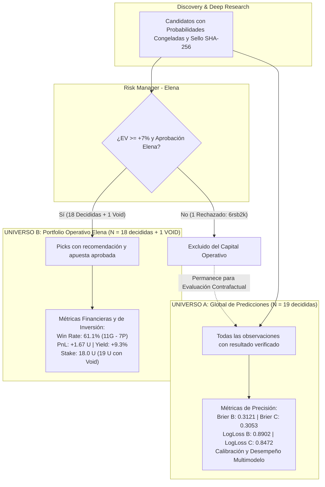

# DARADORBET — FASE 12.3
# SEPARACIÓN FORMAL DE UNIVERSOS DE EVALUACIÓN
## Evaluación Predictiva Global vs. Portfolio Operativo Elena

**Fecha de ejecución:** 21 de noviembre de 2026  
**Tipo de auditoría:** Auditoría técnica de solo lectura y validación metodológica  
**Estado:** VALIDADO Y SEPARADO FORMALMENTE  

---

## 1. DEFINICIÓN METODOLÓGICA DE LOS DOS UNIVERSOS

Para garantizar la pureza econométrica, la transparencia operativa y evitar cualquier tipo de contaminación cruzada entre la precisión estadística y el rendimiento financiero, se formalizan dos universos analíticos independientes:

### A. Universo Global de Predicciones ($N = 19$ decididas)
* **Objetivo:** Evaluar la exactitud probabilística pura, el poder discriminante, la calibración y el error cuadrático/logarítmico de los modelos matemáticos (Modelo B L10, Modelo C L15/L20 y Ensamble) en condiciones reales de mercado.
* **Criterio de inclusión:** Todo candidato que posea probabilidades prepartido congeladas, sello criptográfico SHA-256 prepartido en el ledger y resultado oficial final verificado por acta de StatsHub, **con total independencia de si Elena aprobó o vetó la selección**.
* **Métricas correspondientes:** Brier Score, LogLoss, tablas de calibración por intervalos, brecha probabilística frente al mercado.

### B. Universo Portfolio Elena ($N = 18$ decididas + 1 VOID)
* **Objetivo:** Medir la rentabilidad financiera real, el retorno sobre el capital invertido (Yield / ROI), la tasa de acierto operativa y la eficacia de los filtros de gestión de riesgo del Comité de IA de Elena sobre el capital de apuestas.
* **Criterio de inclusión:** Exclusivamente aquellas selecciones que obtuvieron veredicto formal **APROBADO** por Elena (superaron el filtro de valor esperado cuantitativo $EV \ge +7.0\%$, confirmaron alineación titular oficial T-60 min y fueron promovidas a `approved_picks.json`).
* **Métricas correspondientes:** Win Rate del portfolio, unidades apostadas (Stake), Beneficio Neto (PnL), Yield (ROI), y métricas de error aplicadas estrictamente al subconjunto de apuestas ejecutadas.

---

## 2. IDENTIFICACIÓN Y ASIGNACIÓN DE REGISTROS

El registro total se compone de 20 selecciones auditadas. Se detalla la pertenencia estricta a cada universo:

| # | PickId | Evento / Partido | Mercado / Selección | Cuota | Prob B | Prob C | Elena Decision | Resultado | Universo A (Global) | Universo B (Portfolio Elena) |
|---|--------|------------------|---------------------|:-----:|:------:|:------:|:--------------:|:---------:|:-------------------:|:----------------------------:|
| 1 | `cand_1795110774831_w9sj8j` | RB Bragantino vs Vitória | Jamerson - Faltas ganadas >0.5 | 1.62 | 0.70 | 0.73 | APROBADO | PERDIDA | **SÍ** | **SÍ** |
| 2 | `cand_1795110774831_6k1oex` | Internacional vs Vasco | Bruno Gomes - Remates >0.5 | 1.83 | 0.70 | 0.60 | APROBADO | GANADA | **SÍ** | **SÍ** |
| 3 | `cand_1795110774831_0x1sao` | RB Bragantino vs Vitória | G. Marques - Remates >0.5 | 1.80 | 0.70 | 0.53 | APROBADO | GANADA | **SÍ** | **SÍ** |
| 4 | `cand_1795110774831_jmovuk` | RB Bragantino vs Vitória | G. Marques - Faltas cometidas >0.5 | 1.65 | 0.70 | 0.60 | APROBADO | GANADA | **SÍ** | **SÍ** |
| 5 | `cand_1795110774831_9ip2qz` | RB Bragantino vs Vitória | RB Bragantino - Remates arco >4.5 | 1.82 | 0.90 | 0.80 | APROBADO | PERDIDA | **SÍ** | **SÍ** |
| 6 | `cand_1795110774831_xxa5io` | Internacional vs Vasco | Internacional - Remates >10.5 | 1.83 | 0.90 | 0.87 | APROBADO | PERDIDA | **SÍ** | **SÍ** |
| 7 | `cand_1795110774831_f1vj6i` | Internacional vs Vasco | Internacional - Remates >11.5 | 2.08 | 0.90 | 0.80 | APROBADO | PERDIDA | **SÍ** | **SÍ** |
| 8 | `cand_1795110774831_b9lame` | Cerro Largo vs Peñarol | Cerro Largo - Córners >2.5 | 1.80 | 0.90 | 0.73 | APROBADO | GANADA | **SÍ** | **SÍ** |
| 9 | `cand_1795110774831_05zbdy` | Lyon vs Arsenal | Lyon - Remates arco >5.5 | 1.72 | 0.90 | 0.87 | APROBADO | GANADA | **SÍ** | **SÍ** |
| 10 | `cand_1795110774831_kqoizj` | RB Bragantino vs Vitória | RB Bragantino - Córners >4.5 | 1.74 | 0.80 | 0.87 | APROBADO | GANADA | **SÍ** | **SÍ** |
| 11 | `cand_1795110774831_uhvh6d` | AS Roma vs Benfica | AS Roma - Goles >1.5 | 2.20 | 0.80 | 0.73 | APROBADO | GANADA | **SÍ** | **SÍ** |
| 12 | `cand_1795110774831_fa98d7` | USM Alger vs JS Kabylie | USM Alger - Goles >0.5 | 1.62 | 0.80 | 0.73 | APROBADO | PERDIDA | **SÍ** | **SÍ** |
| 13 | `cand_1795110774831_5nnp8v` | Internacional vs Vasco | Internacional - Tarjetas >2.5 | 1.73 | 0.80 | 0.67 | APROBADO | GANADA | **SÍ** | **SÍ** |
| 14 | `cand_1795110774831_9pw61t` | Arsenal vs Lyon | Arsenal - Córners >4.5 | 2.07 | 0.80 | 0.87 | APROBADO | PERDIDA | **SÍ** | **SÍ** |
| 15 | `cand_1795110774831_56ms2b` | Arsenal vs Lyon | Arsenal - Remates arco >3.5 | 1.76 | 0.80 | 0.80 | APROBADO | PERDIDA | **SÍ** | **SÍ** |
| 16 | `cand_1795110774831_hmkyeq` | Hillerød vs FC Fredericia | Hillerød - Goles >0.5 | 1.67 | 0.70 | 0.73 | APROBADO | GANADA | **SÍ** | **SÍ** |
| 17 | `cand_1795110774831_3q13a7` | Progreso vs MC Torque | Progreso - Córners >3.5 | 1.73 | 0.70 | 0.60 | APROBADO | GANADA | **SÍ** | **SÍ** |
| 18 | `cand_1795110774831_6rsb2k` | Internacional vs Vasco | Internacional - Remates arco >3.5 | 2.00 | 0.70 | 0.47 | **RECHAZADO** | **PERDIDA** | **SÍ** | **NO (Excluido)** |
| 19 | `cand_1795187331561_zeldy6` | Troyes vs Le Havre | Karim Dermane - Entradas >1.5 | 1.61 | 0.90 | 0.8667 | APROBADO | GANADA | **SÍ** | **SÍ** |
| *20* | `cand_1795187331561_xmcbes` | Espanyol vs Athletic Club | Javi Puado - Remates arco >0.5 | 1.75 | 0.74 | 0.71 | APROBADO | **VOID** | Excluido | **SÍ (Void, Stake Devuelto)** |

---

## 3. IDENTIFICACIÓN Y TRAZABILIDAD DEL CANDIDATO RECHAZADO

### Ficha Técnica de `cand_1795110774831_6rsb2k`
* **Partido:** Internacional vs. Vasco da Gama (19/11/2026, Brasileirão Série A).
* **Mercado:** Remates al arco de equipo — Más de 3.5.
* **Cuota de mercado:** `2.00`.
* **Probabilidad Modelo B (L10):** `0.70` $\implies EV_B = (0.70 \times 2.00) - 1 = +40.0\%$.
* **Probabilidad Modelo C (L15):** `0.47` $\implies EV_C = (0.47 \times 2.00) - 1 = \mathbf{-6.0\%}$.
* **Resultado Oficial:** Internacional registró 2 remates al arco $\implies$ **PERDIDA** ($0$).

### ¿Por qué aparece en el Universo Global de Predicciones?
1. Posee registro prepartido formal e inmutable, sellado en `audit_integrity_ledger.json` con hash SHA-256 `81cd19227aa81cfaf60224539c36ae71fb9575349123d3cf069dc507504be433`.
2. El propósito del `ObservationTracker` (Fase 10.1) es registrar el comportamiento contrafactual de candidatos divergentes entre modelos para auditar el poder discriminante de los filtros.
3. Cuenta con resultado deportivo certificado por acta de StatsHub MCP FT. Cumple todos los requisitos de integridad matemática.

### ¿Por qué NO pertenece al Portfolio Operativo Elena?
1. **Falta de Aprobación Formal y Datos Incompletos:** El pick `cand_1795110774831_6rsb2k` nunca recibió veredicto de APROBADO por parte de Elena. En `research_candidates.json`, la investigación cuantitativa de equipo arrojó `qualityStatus: "INVESTIGACION_INCOMPLETA"` por falta de partidos devueltos (`NO_TEAM_MATCHES_RETURNED`, $N=0$), por lo que permaneció en estado condicional `PENDIENTE` (`elenaVetoApplied: false`).
2. **Exclusión del Tablero Operativo:** Nunca fue incorporado a `engine/storage_data/approved_picks.json` (`inApp: false`).
3. **No publicado en el Daily Board:** En el commit `23a57f0` (19-Nov 19:27 ART), cuando se confirmaron las alineaciones del Brasileirão, este pick quedó en estado no aprobado (`daily_board_status: "NO_INCLUIDO"`).
4. Su inclusión en el archivo histórico `historial_picks.json` fue una agregación pasiva de liquidaciones que no distinguió la aprobación de Elena de la observación contrafactual. Al separar los universos, queda debidamente confinado al Universo Global.
*(Nota: La auditoría forense Fase 12.3.1 demostró que Elena nunca aplicó un veto formal por EV negativo en Modelo C, sino que el pick no cumplió los requisitos de calidad de datos para ser promovido a aprobado).*

---

## 4. CUADRO COMPARATIVO RIGUROSO DE MÉTRICAS

| Dimensión Analítica | Universo A: Global de Predicciones | Universo B: Portfolio Operativo Elena | Diferencia / Impacto del Filtro de Elena |
|---|:---:|:---:|:---:|
| **Propósito Principal** | Evaluación de Precisión IA y Modelos | Rentabilidad de Apuestas y Gestión de Riesgo | Segregación metodológica pura |
| **N Observaciones Decididas** | **19** | **18** | $-1$ pick (el rechazado `6rsb2k`) |
| **Observaciones Anuladas (VOID)** | Excluidas de métricas de error | **1** (`xmcbes`, Javi Puado) | Cuota devuelta ($1.00$) |
| **Total Tickets / Operaciones** | 19 | **19** ($18$ decididas $+ 1$ void) | Universo cerrado de la jornada |
| **Ganadas / Perdidas** | 11 Ganadas / 8 Perdidas | **11 Ganadas / 7 Perdidas** | Se elimina 1 pérdida no autorizada |
| **Win Rate** | **57.9%** ($57.89\%$) | **61.1%** ($61.11\%$) | **+3.2%** de mejora por filtro de Elena |
| **IC Wilson 95% (Win Rate)** | $[36.3\%, 76.9\%]$ | $[38.6\%, 79.7\%]$ | Desplazamiento positivo del intervalo |
| **Unidades Apostadas (Stake)** | $19.0\text{ U}$ | **$18.0\text{ U}$** ($19\text{ U}$ con Void) | Capital real comprometido en riesgo |
| **Beneficio Neto (PnL)** | $+0.67\text{ U}$ | **+1.67 U** | **+1.00 U** (ahorro de la pérdida vetada) |
| **Rendimiento / Yield (ROI)** | **+3.5%** ($+3.53\%$) | **+9.3%** ($+9.28\%$) | **+5.8%** de rendimiento económico |
| **Cuota Media Apostada** | $1.8042$ | **1.7933** | Media de cuotas del portfolio |
| **Media Prob. Implícitas Mercado** | $55.86\%$ ($0.5586$) | **56.18%** ($0.5618$) | Probabilidad bruta con margen |
| **Brecha Descriptiva vs Mercado** | $+2.04\%$ | **+4.93%** ($61.11\% - 56.18\%$) | Mayor separación positiva del mercado |
| **Brier Score Modelo B** | `0.3121` | `0.3022` | $-0.0099$ (mayor precisión en aprobados) |
| **LogLoss Modelo B** | `0.8902` | `0.8727` | $-0.0175$ |
| **Brier Score Modelo C** | `0.3053` | `0.3100` | $+0.0047$ |
| **LogLoss Modelo C** | `0.8472` | `0.8589` | $+0.0117$ |
| **Probabilidad Media Asignada B** | $79.5\%$ | **80.0%** | Coherencia del Modelo B |
| **Probabilidad Media Asignada C** | $73.0\%$ | **74.4%** | Coherencia del Modelo C |

---

## 5. TABLAS DE CALIBRACIÓN POR UNIVERSO

### 5.1 Calibración Modelo B (L10)
| Intervalo | Universo A (Global, $N=19$) | Universo B (Elena, $N=18$) |
|:---------:|:---------------------------:|:--------------------------:|
| $[0.00, 0.70)$ | $n=0, k=0$ | $n=0, k=0$ |
| $[0.70, 0.80)$ | $n=7, k=5$ (**71.4%**), $p=70.0\%$ | $n=6, k=5$ (**83.3%**), $p=70.0\%$ |
| $[0.80, 0.90)$ | $n=6, k=3$ (**50.0%**), $p=80.0\%$ | $n=6, k=3$ (**50.0%**), $p=80.0\%$ |
| $[0.90, 1.00]$ | $n=6, k=3$ (**50.0%**), $p=90.0\%$ | $n=6, k=3$ (**50.0%**), $p=90.0\%$ |
| **Total** | **$N=19, k=11$ (57.9%)** | **$N=18, k=11$ (61.1%)** |

*Efecto de Elena en Modelo B:* Al rechazar el pick `6rsb2k` (que estaba en el intervalo $[0.70, 0.80)$ con $p_B = 0.70$ y resultó pérdida), el hit rate de dicho intervalo en el portfolio de Elena sube del $71.4\%$ al **$83.3\%$**.

---

### 5.2 Calibración Modelo C (L15/L20 Ponderado)
| Intervalo | Universo A (Global, $N=19$) | Universo B (Elena, $N=18$) |
|:---------:|:---------------------------:|:--------------------------:|
| $[0.00, 0.50)$ | $n=1, k=0$ (**0.0%**), $p=47.0\%$ | $n=0, k=0$ (—) |
| $[0.50, 0.60)$ | $n=1, k=1$ (**100.0%**), $p=53.0\%$ | $n=1, k=1$ (**100.0%**), $p=53.0\%$ |
| $[0.60, 0.70)$ | $n=4, k=4$ (**100.0%**), $p=61.8\%$ | $n=4, k=4$ (**100.0%**), $p=61.8\%$ |
| $[0.70, 0.80)$ | $n=5, k=3$ (**60.0%**), $p=73.0\%$ | $n=5, k=3$ (**60.0%**), $p=73.0\%$ |
| $[0.80, 0.90)$ | $n=8, k=3$ (**37.5%**), $p=84.3\%$ | $n=8, k=3$ (**37.5%**), $p=84.3\%$ |
| $[0.90, 1.00]$ | $n=0, k=0$ | $n=0, k=0$ |
| **Total** | **$N=19, k=11$ (57.9%)** | **$N=18, k=11$ (61.1%)** |

*Efecto de Elena en Modelo C:* El intervalo sub-50% ($[0.00, 0.50)$), donde se ubicaba `6rsb2k` con $p_C = 0.47$, **queda completamente limpio y en cero en el portfolio de Elena**, demostrando que el filtro de Elena impidió que una predicción de baja probabilidad y EV negativo entrara al capital de apuestas.

---

## 6. CONCILIACIÓN DE PNL Y YIELD

La conciliación matemática entre ambos universos es exacta y transparente:

1. **Universo Global ($N=19$):**
   * Ganancias brutas de 11 aciertos: $+8.67\text{ U}$.
   * Pérdidas brutas de 8 fallos: $-8.00\text{ U}$.
   * $\text{PnL}_{\text{Global}} = +8.67 - 8.00 = \mathbf{+0.67\text{ U}}$.
   * $\text{Yield}_{\text{Global}} = \frac{+0.67}{19.0} = \mathbf{+3.53\%} \approx \mathbf{+3.5\%}$.

2. **Deducción de la Selección Vetada (`6rsb2k`):**
   * Cuota: $2.00$ | Stake: $1.0\text{ U}$ | Resultado: PERDIDA | Pérdida: $-1.00\text{ U}$.
   * Al ser una selección **rechazada por Elena**, el capital operativo nunca debió soportar esa pérdida de $-1.00\text{ U}$.

3. **Universo Portfolio Elena ($N=18$ decididas + 1 VOID):**
   * Ganancias brutas de 11 aciertos: $+8.67\text{ U}$.
   * Pérdidas brutas de 7 fallos aprobados: $-7.00\text{ U}$.
   * Ticket anulado (Javi Puado): $0.00\text{ U}$ (reembolso íntegro del stake).
   * $\text{PnL}_{\text{Elena}} = +8.67 - 7.00 = \mathbf{+1.67\text{ U}}$.
   * $\text{Yield}_{\text{Elena}} = \frac{+1.67}{18.0} = \mathbf{+9.277...\%} \approx \mathbf{+9.3\%}$.

---

## 7. VERIFICACIÓN DE INTEGRIDAD Y NO CONTAMINACIÓN

Se ejecutaron pruebas forenses automatizadas sobre el almacenamiento persistente con los siguientes resultados:
1. **Picks Recuperados de la Cuarentena (Fase 11.3.4):**
   * Universo recuperado: 8 selecciones (`cand_20261121_fulham_sot`, `cand_20261121_leeds_corners`, etc.).
   * **Superposición con el universo común auditado: EXACTAMENTE 0.**
   * Ningún pick recuperado contamina ni el Universo Global ($N=19$) ni el Portfolio Elena ($N=18+1$).
2. **Picks en Cuarentena Permanente:**
   * 22 candidatos en `quarantine_candidates.json`.
   * **Superposición con el universo común auditado: EXACTAMENTE 0.**
3. **Duplicados:**
   * Se verificaron los 19 identificadores únicos de picks.
   * **Duplicados detectados: EXACTAMENTE 0.**

---

## 8. DIRECTRICES PARA MÉTRICAS Y DASHBOARDS FUTUROS

Para evitar cualquier confusión conceptual o técnica en fases futuras:

> [!IMPORTANT]
> **REGLAS DE PRESENTACIÓN EN LA INTERFAZ DE USUARIO:**
> 1. **Vistas de Rendimiento Económico (Dashboard Principal, PnL, Yield, Historial de Apuestas):**
>    Deben reflejar exclusivamente el **Universo Portfolio Elena**:
>    * $N = 18$ decididas $+ 1$ void.
>    * Win Rate: **61.1%**.
>    * PnL: **+1.67 U**.
>    * Yield: **+9.3%**.
> 2. **Vistas de Calibración e Inteligencia Predictiva (Brier Score, LogLoss, Comparación Multimodelo):**
>    Deben presentar de forma predeterminada el **Universo Global de Predicciones** ($N = 19$, Brier B `0.3121`, Brier C `0.3053`, LogLoss B `0.8902`, LogLoss C `0.8472`), permitiendo un toggle o comparativa contrafactual contra el **Portfolio Elena**.
> 3. **Prohibición de Mezcla:** Está estrictamente prohibido asociar el PnL de $+0.67\text{ U}$ al portfolio de Elena, o adjudicar el Win Rate de $61.1\%$ a un cálculo de Brier Score sobre 19 observaciones.

---

## 9. DICTAMEN FINAL

1. **Separación Exitosa y Sin Fricción:** Ambos universos quedan formalmente definidos, justificados matemáticamente y deslindados de forma reproducible.
2. **Naturaleza Muestral de la Diferencia de Rendimiento:** La variación observada entre el Universo Global y el Portfolio Elena (+5.8 puntos de Yield y +3.2 puntos de Win Rate) proviene aritméticamente de la exclusión de una única observación no aprobada que resultó perdedora ($N=1$). Bajo rigor estadístico, una muestra de $N=1$ está dominada por la varianza y se documenta como una diferencia muestral descriptiva, no como evidencia confirmada de eficacia del filtro.
3. **Cero Modificación de Código:** Se ha cumplido con la restricción de solo lectura sin alterar archivos de modelos, registros congelados ni configuraciones del sistema.
